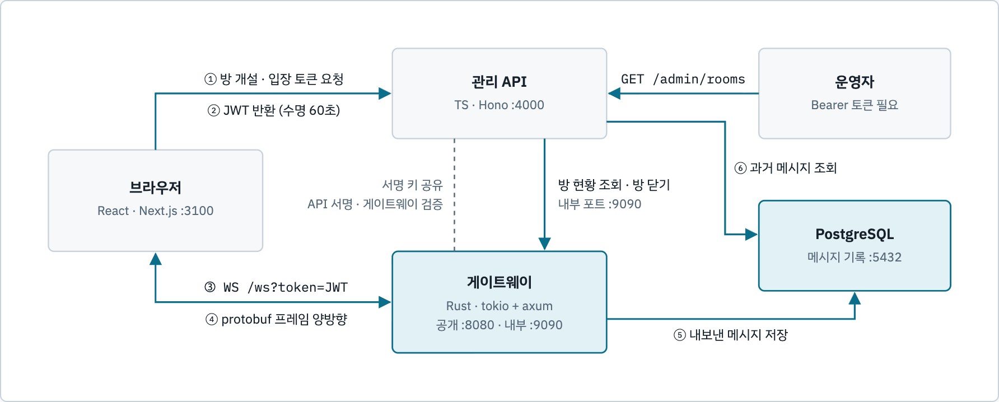
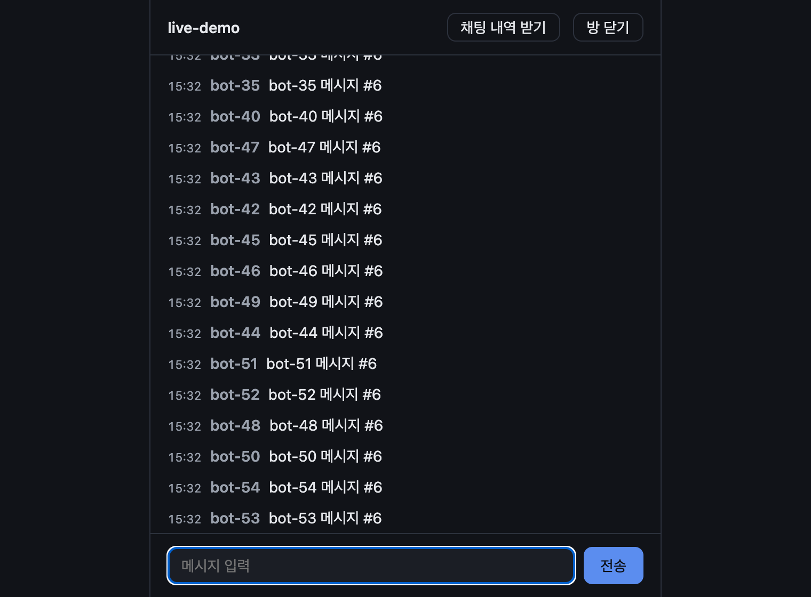
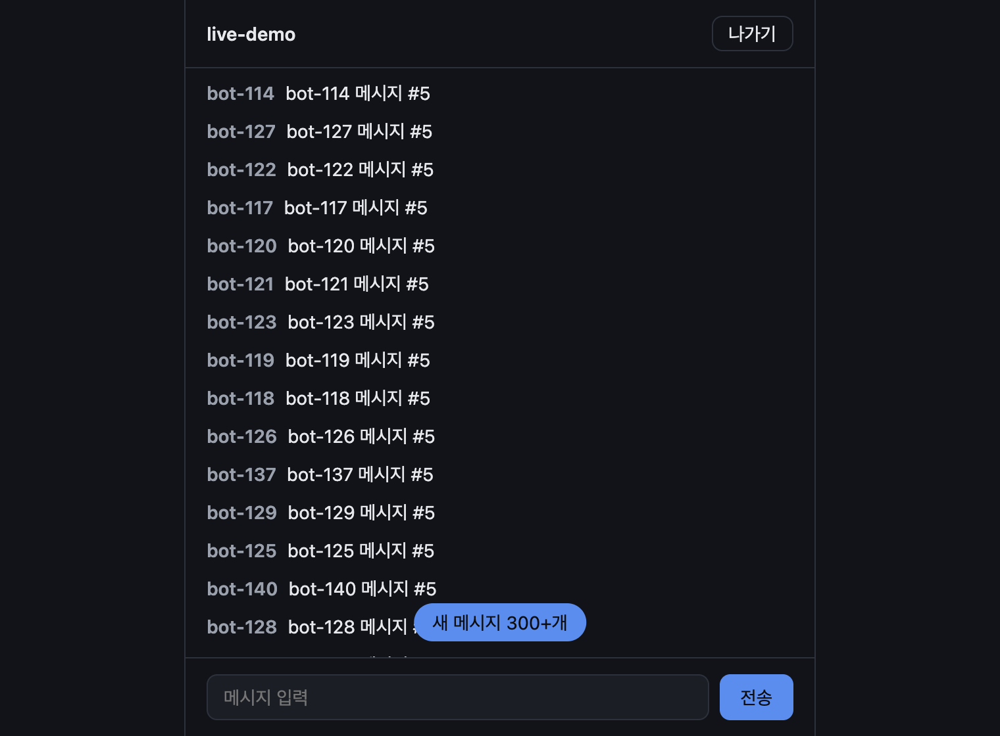

# high-volume-chat

대용량 라이브 채팅 공부용 프로젝트. 한 방에 사람이 많이 몰려도 화면과 서버가 버티게 만드는 것이 목표다.

| 부분 | 기술 | 맡은 일 |
|---|---|---|
| 게이트웨이 | Rust (tokio + axum) | WebSocket 연결을 붙들고 채팅을 중계, 저장 |
| 관리 API | TypeScript (Hono) | 방 개설/닫기, 입장 토큰, 과거 메시지 |
| 웹 | React (Next.js) | 화면 |
| 저장소 | PostgreSQL, Parquet 파일 | 화면에 나간 글 / 받은 글 전부 |



## 기능

- 방 만들기 (같은 ID 중복 거절), 진행 중인 방 목록, 주소 공유로 입장
- 실시간 채팅, 랜덤 닉네임
- 과거 메시지: 입장하면 최근 50개, 위로 올리면 이전 50개씩
- 위로 올려 읽는 동안에는 목록이 멈추고 "새 메시지 N개" / "맨 아래로" 버튼이 뜬다
- 방장: 뱃지 표시, 방 닫기 (전원 퇴장), 채팅 내역 CSV 받기
- 방은 만든 지 24시간 뒤 자동으로 닫힌다
- 화면에 못 나간 글까지 전부 파일로 보관하고 SQL로 조회

## 핵심 아이디어

| 문제 | 해결 |
|---|---|
| 메시지마다 따로 보내면 연결 수만큼 전송이 곱해진다 | 200ms마다 한 묶음으로 보낸다. 인코딩은 한 번만 하고 모든 연결이 공유한다 |
| 유입이 끝없이 늘 수 있다 | 연결별 속도 제한 + 방별 상한 (기본 초당 1,000건). 넘치면 줄 세우지 않고 버린다 |
| 느린 한 명이 전체를 늦춘다 | 그 연결만 오래된 프레임을 건너뛰고, 계속 못 받으면 끊는다 |
| DB가 느려지면 채팅도 느려진다 | 전송과 저장을 분리. 대기줄에 넣기만 하고 기다리지 않는다 |
| 메시지가 올 때마다 그리면 브라우저가 멈춘다 | 버퍼에 모았다가 화면 프레임당 한 번만 반영, 최근 300개만 유지, 보이는 줄만 그림 |
| 버려진 글은 영영 사라진다 | 받은 글 전부를 30초마다 Parquet 파일로 쌓는다 (조회가 빨라야 하는 것만 PostgreSQL) |
| 로그인 없이 방장을 알아봐야 한다 | 방을 만들 때 열쇠를 주고 DB에는 해시만 둔다 |
| 닫힌 방에 남은 토큰으로 다시 들어온다 | 토큰에 방의 회차를 싣고, 닫힌 회차와 지난 회차는 게이트웨이가 거절한다 |

## 대용량일 때

봇 200개로 초당 200건을 넣은 방. 왼쪽은 따라가는 중, 오른쪽은 위로 올려서 멈춘 상태.

| | |
|---|---|
|  |  |

| 유입 | 화면에 나감 | 화면 갱신 | 실제 DOM 줄 수 |
|---|---|---|---|
| 초당 200건 | 100% | 초당 60회 | 17 |
| 초당 1,000건 | 86% | 초당 60회 | 17 |

게이트웨이 한 개에 연결 10,000개, 유입 초당 10,000건까지 붙여봤다 (맥북 한 대, 접속 실패와 뒤처진 연결 0). 자동 테스트에서는 연결 10,200개가 같은 순서로 중복/누락 없이 받는 것을 확인했다.

## 실행

필요한 것: Node 24+, Rust, Docker.

```sh
cp .env.example .env                       # JOIN_TOKEN_SECRET, ADMIN_API_TOKEN 채우기
cp apps/web/.env.example apps/web/.env.local
npm install
npm run db:up                              # PostgreSQL :5432

npm run dev:gateway                        # :8080
npm run dev:api                            # :4000
npm run dev:web                            # :3100 → http://localhost:3100
```

## 테스트와 도구

```sh
npm run test:gateway                       # 게이트웨이 테스트 21개 (실제 서버, 실제 DB)
npm run loadgen -- <방 ID> <봇 수> <초>     # 만들어 둔 방에 봇을 붙여 화면으로 부하 보기
npm run archive:sql                        # 보관 파일 조회 (방별 받은 글, 나간 글, 버려진 글)
```

## 더 자세히

[docs/IMPLEMENTATION.md](docs/IMPLEMENTATION.md): 백엔드 구조, WebSocket 프레임, 화면 렌더링, 전체 기록 보관, 방의 회차, API 목록, 설정값, 측정값, 구조도 6장.

## 아직 안 된 것

- 로그인이 없다. 방장 열쇠와 닉네임은 그 브라우저에만 있다
- 속도 제한이 연결 단위라 탭을 여러 개 열면 늘어난다
- 채팅 기록과 보관 파일을 지우는 로직이 없다
- 게이트웨이가 한 대다. 늘리려면 서버 사이에 메시지를 전달하는 통로가 필요하다
- API와 웹에는 자동 테스트가 없다
