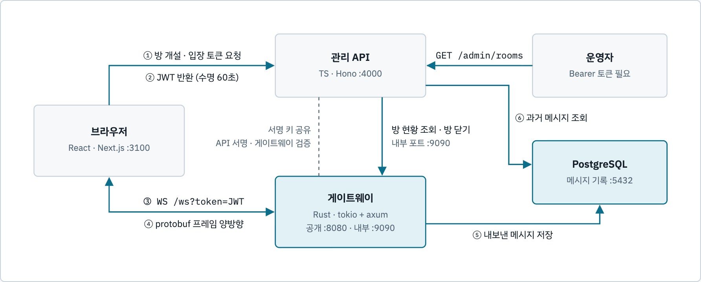
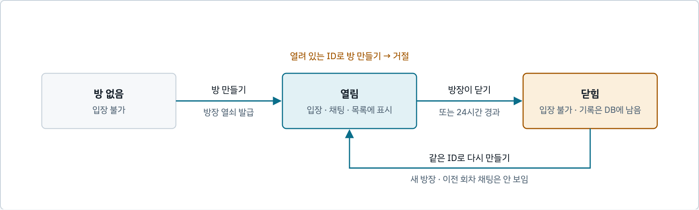
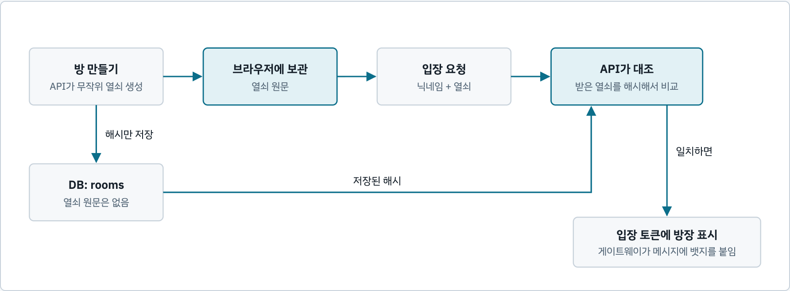
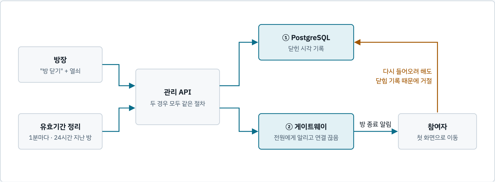
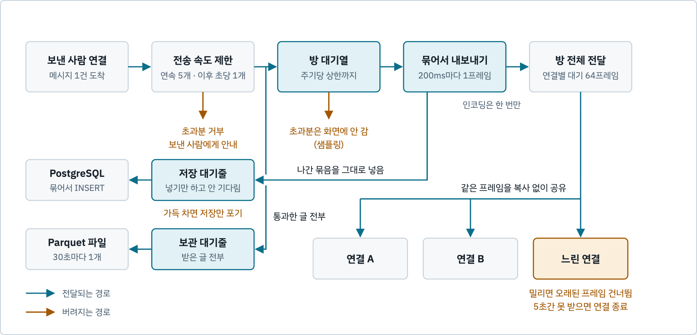
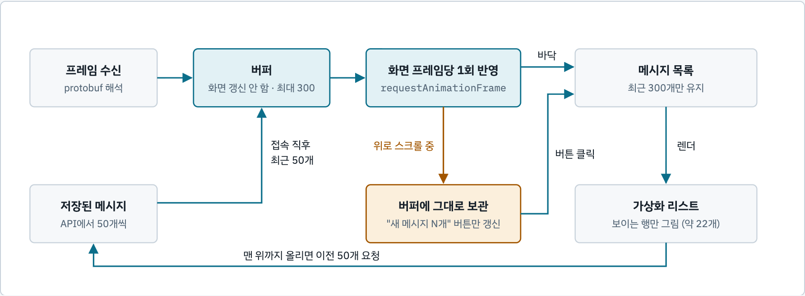
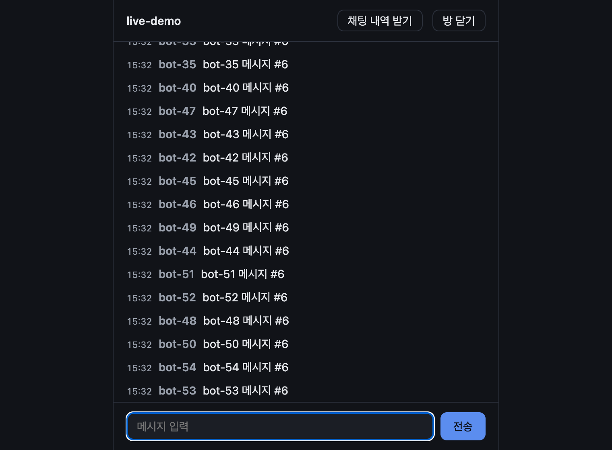
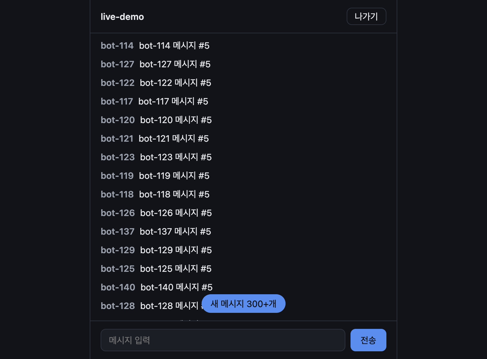
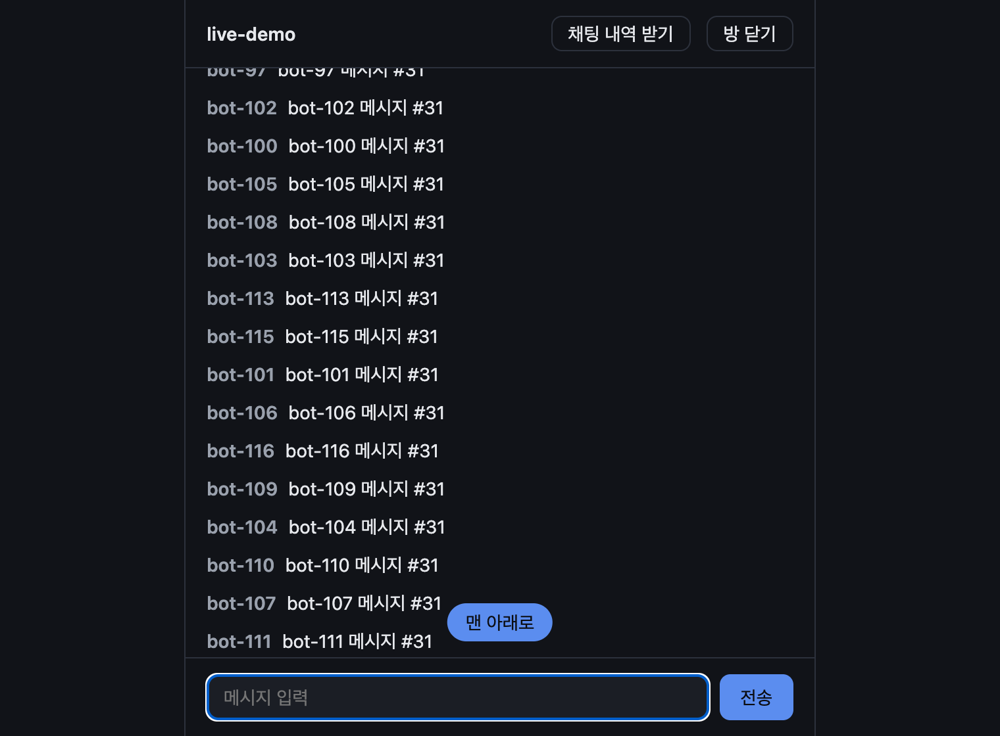
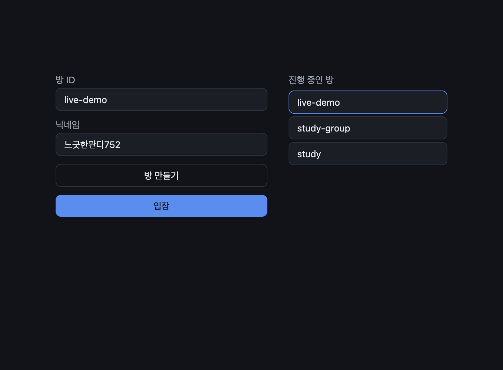

# 구현 설명

[README](../README.md)의 요약을 풀어 쓴 문서다. 그림과 측정값, API와 설정값 전체가 여기 있다.

대용량 라이브 채팅 공부용 프로젝트. 한 방에 사람이 많이 몰려도 화면과 서버가 버티게 만드는 것이 목표다.

- **게이트웨이** (Rust): WebSocket 연결을 붙들고 채팅을 중계한다
- **관리 API** (TypeScript): 방 개설, 입장 토큰, 과거 메시지, 방 닫기
- **웹** (React, Next.js): 화면
- **PostgreSQL**: 방 정보와 화면에 나간 채팅 기록
- **Parquet 파일**: 받은 채팅 전체 (화면에 못 나간 것 포함)

## 목차

- [할 수 있는 것](#할-수-있는-것)
- [구조](#구조)
- [어떻게 구현했나](#어떻게-구현했나): 전체 구성, 백엔드, WebSocket, 화면 렌더링, 전체 기록 보관, 대용량일 때 모습
- [설계에서 고른 것과 이유](#설계에서-고른-것과-이유)
- [실행](#실행)
- [API](#api)
- [DB](#db)
- [테스트](#테스트)
- [튜닝 값](#튜닝-값-env)
- [아직 안 된 것, 알려진 한계](#아직-안-된-것-알려진-한계)

## 할 수 있는 것

| 기능 | 설명 |
|---|---|
| 방 만들기 | 방 ID를 정해 개설한다. 열려 있는 같은 ID가 있으면 거절된다 |
| 진행 중인 방 목록 | 첫 화면 오른쪽에 뜬다. 5초마다 갱신된다 |
| 입장 | 개설된 방에만 들어갈 수 있다. 방 주소(`/rooms/방ID`)를 공유해도 된다 |
| 닉네임 | 처음에 랜덤으로 만들어 주고 브라우저에 기억한다. 직접 고칠 수 있다 |
| 채팅 | 실시간 전송. 한 사람은 연속 5건, 이후 1초에 1건까지 |
| 과거 메시지 | 입장하면 최근 50개가 보이고, 위로 끝까지 올리면 이전 50개씩 불러온다 |
| 읽는 중 멈춤 | 위로 올려 지난 글을 보는 동안에는 목록이 밀리지 않는다. 그동안 온 글은 "새 메시지 N개" 버튼에 쌓인다 (300개를 넘으면 `300+`) |
| 맨 아래로 | 위로 올려 둔 상태에서 버튼 하나로 가장 최근 글로 내려간다 |
| 방장 | 방을 만든 사람. 메시지에 `방장` 뱃지가 붙는다 |
| 방 닫기 | 방장만 가능. 닫으면 모두 첫 화면으로 나간다 |
| 채팅 내역 받기 | 방장만 가능. CSV 파일로 내려받는다 |
| 유효기간 | 방은 만든 지 24시간이 지나면 자동으로 닫힌다 |
| 전체 기록 보관 | 화면에 못 나간 글까지 전부 파일로 쌓고 SQL로 조회한다 |

## 구조

```
proto/chat/v1/chat.proto   WebSocket 프레임 형식 (Rust와 TS 타입의 단일 원본)
gateway/                   Rust (tokio + axum). 연결 유지, 토큰 검증, 전송 속도 제한, 묶음 전송, 샘플링, 저장
apps/api/                  TS (Hono). 방 개설/닫기, 입장 토큰, 과거 메시지 조회, CSV 내보내기
apps/web/                  React (Next.js). 버퍼 + 프레임당 1회 반영, 가상화 리스트
db/schema.sql              테이블 정의 (rooms, chat_messages)
docker-compose.yml         로컬 PostgreSQL
tools/archive-sql.mjs      보관 파일 조회 도구
data/archive/              보관 파일이 쌓이는 곳 (git에는 올리지 않는다)
```

전부 한 컴퓨터에서 돌고 포트로 구분한다.

| 프로그램 | 포트 |
|---|---|
| 웹 | 3100 |
| 관리 API | 4000 |
| 게이트웨이 | 8080 (공개), 9090 (내부 전용) |
| PostgreSQL | 5432 |

## 어떻게 구현했나

### 1. 전체 구성



채팅은 관리 API를 거치지 않는다. API는 접속 직전에 토큰만 발급하고, 메시지는 브라우저와 게이트웨이 사이의 WebSocket으로만 오간다. 그래서 채팅이 몰려도 API는 한가하다. DB에 쓰는 것은 게이트웨이, 읽는 것은 API다.

### 2. 백엔드 구현

백엔드는 둘로 나뉜다.

| | 관리 API (TypeScript, Hono) | 게이트웨이 (Rust, tokio + axum) |
|---|---|---|
| 맡은 일 | 방 개설/닫기, 입장 토큰 발급, 과거 메시지 조회, CSV 내보내기 | 연결 유지, 메시지 중계, 저장 |
| 요청 빈도 | 사람당 가끔 (입장할 때, 위로 스크롤할 때) | 연결이 붙어 있는 내내 |
| DB | 읽기 위주 | 쓰기만 |

자주 바뀌는 업무 규칙은 고치기 쉬운 TypeScript에, 연결 수만 개를 붙들어야 하는 부분은 Rust에 두었다.

#### 방의 일생



방의 상태는 `rooms` 테이블의 닫힌 시각 칸 하나로 구분한다. 비어 있으면 열림이다. "같은 ID가 이미 열려 있나"는 코드가 먼저 조회해서 판단하지 않고, DB의 기본 키 충돌로 한 문장에서 가린다 (`apps/api/src/rooms/insertRoom.ts`). 여러 명이 같은 ID로 동시에 만들어도 한 명만 성공한다.

#### 방장을 알아보는 방법



로그인이 없어서 "누구인지" 대신 "방을 만들 때 받은 열쇠를 갖고 있는지"로 판단한다. API가 무작위 열쇠를 만들어 한 번 내려주고, DB에는 원문으로 되돌릴 수 없는 해시만 저장한다. 입장할 때 열쇠를 같이 보내 맞으면 입장 토큰에 방장 표시가 실리고, 게이트웨이가 그 사람의 메시지에 뱃지를 붙인다.

#### 방 닫기



방장이 닫거나 유효기간(24시간)이 지나면 같은 절차를 밟는다. 순서가 핵심이다. ① DB에 먼저 기록해 새 입장을 막고, ② 그다음 붙어 있는 사람을 내보낸다. 반대로 하면 내보낸 사람이 재접속해서 다시 들어올 틈이 생긴다.

닫힌 방의 ID는 새 방으로 다시 열 수 있다. 방장 열쇠가 새로 발급되고, 이전 회차의 채팅은 새 방에서 보이지 않는다 (DB에는 남는다).

#### 방의 회차

입장 토큰은 발급 후 60초 동안 서명이 유효하다. 그래서 "DB에 닫혔다고 적었으니 새 토큰이 안 나온다"만으로는 부족하다. 닫히기 직전에 받은 토큰이 남아 있기 때문이다. 이를 막으려고 토큰에 **방의 회차**(방을 만든 시각)를 싣는다 (`gateway/src/room/registry.rs`).

| 상황 | 게이트웨이의 판단 |
|---|---|
| 닫힌 회차(또는 그 이전)의 토큰 | 거절. 마지막 사람이 나가 방이 사라진 뒤에도 닫힌 사실을 3분간 기억한다 |
| 지금 떠 있는 방보다 이전 회차의 토큰 | 거절 |
| 지금 떠 있는 방보다 새 회차의 토큰 | 같은 ID로 방이 다시 열린 것이다. 이전 방을 닫아 남은 사람을 내보내고 새 방을 만든다 |

유효기간이 지난 방의 ID로 새 방을 만들면 (정리 작업이 돌기 전이라도) API가 게이트웨이에 이전 회차를 닫으라고 알린다. 이전 참여자가 새 방에 남지 않는다.

#### 메시지 한 건이 게이트웨이를 지나는 길



1. 보낸 사람 연결에서 **전송 속도 제한**을 통과해야 한다. 연속 5건, 이후 초당 1건. 넘으면 거절하고 보낸 사람에게 알린다. 빈 글, 너무 긴 글, NUL 문자가 든 글도 여기서 거절한다 (NUL은 PostgreSQL에 저장할 수 없다)
2. 방의 대기열에 쌓인다. **200ms마다 정해진 개수까지만** 받고 넘치는 것은 버린다 (샘플링). 개수는 설정값이다 (`ROOM_MAX_MESSAGES_PER_FLUSH`, 기본 200)
3. 200ms마다 쌓인 것을 **한 프레임으로 묶어** 방의 모든 연결에 보낸다. 인코딩은 한 번만 하고 같은 데이터를 복사 없이 공유한다
4. 보낸 묶음은 **저장 대기줄**에도 들어간다. 별도 작업이 꺼내서 PostgreSQL에 한 번에 INSERT 한다. 전송은 DB를 기다리지 않는다. DB가 묶음을 거절하면 한 건씩 다시 넣어 문제 있는 행만 버린다 (한 행 때문에 다른 방의 정상 글까지 잃지 않는다)
5. 2번에서 받았든 버렸든, 속도 제한을 통과한 글은 전부 **보관 대기줄**에 들어가 Parquet 파일로 쌓인다 (아래 "전체 기록 보관")

버리는 지점이 세 곳이다. 한 사람이 너무 빨리 보내면 입구에서, 방 전체가 붐비면 대기열에서, 받는 쪽이 느리면 그 연결에서만 버린다. 그래서 방 하나가 내보내는 양에는 **항상 상한이 있다** (기본값으로 초당 1,000건). 아무리 몰려도 그 이상은 나가지 않는다.

### 3. WebSocket은 어떻게 쓰였나

**연결은 사람마다 하나, 그걸 붙드는 서버 프로그램은 하나다.** 10,000명이 들어오면 연결이 10,000개 생기고, 게이트웨이 한 개가 전부 붙든다.

| 단계 | 내용 |
|---|---|
| 접속 | `GET /ws?token=...`. 브라우저 WebSocket은 헤더를 실을 수 없어 토큰을 주소에 싣는다. 그래서 토큰 수명을 60초로 짧게 둔다 |
| 검증 | 게이트웨이는 토큰의 서명만 확인한다. DB나 API에 묻지 않아서 동시에 수만 명이 들어와도 버틴다 |
| 형식 | 글자(JSON)가 아닌 바이너리(protobuf). `proto/chat/v1/chat.proto` 하나에서 Rust와 TS 타입을 같이 만든다 |
| 재접속 | 끊기면 0.5초부터 최대 15초까지 간격을 늘려가며 다시 붙는다. 간격을 조금씩 흩어서 게이트웨이가 재시작될 때 모두가 한순간에 몰리지 않게 한다. 재접속 때마다 토큰을 새로 받으므로 방이 아직 열려 있는지도 다시 확인된다 |

오가는 프레임은 네 종류뿐이다.

| 방향 | 프레임 | 내용 |
|---|---|---|
| 브라우저 → 서버 | `send_message` | 보낼 글. 닉네임은 싣지 않는다 (접속할 때 토큰으로 정해진다) |
| 서버 → 브라우저 | `batch` | 200ms 동안 모인 메시지 묶음 |
| 서버 → 브라우저 | `error` | 속도 제한에 걸렸거나 보낼 수 없는 글 |
| 서버 → 브라우저 | `room_closed` | 방이 닫혔다. 이 뒤에 서버가 연결을 끊는다 |

게이트웨이에서 연결 하나는 세 가지를 동시에 기다린다 (`gateway/src/ws/session.rs`).

- 방에서 내려온 묶음 → 이 연결로 보낸다. 5초 안에 못 보내면 죽은 연결로 보고 끊는다
- 브라우저가 보낸 글 → 속도 제한을 확인하고 방 대기열에 넣는다
- 방이 닫혔다는 신호 → 알리고 끊는다

느린 연결은 그 연결만 손해를 본다. 연결마다 대기 프레임 64개까지 쌓이고, 넘치면 오래된 것을 건너뛰고 최신부터 이어 받는다.

### 4. 화면은 어떻게 그리나



메시지가 올 때마다 화면을 다시 그리면 브라우저가 멈춘다. 그래서 세 가지를 한다 (`apps/web/src/features/chat/hooks/useChatRoomConnection.ts`).

1. **모았다가 한 번에**: 받은 메시지는 화면과 무관한 버퍼에 쌓고, 화면 프레임당 한 번(`requestAnimationFrame`)만 목록에 반영한다. 초당 몇 건이 오든 화면 갱신은 주사율(보통 초당 60회)을 넘지 않는다
2. **최근 300개만**: 목록이 300개를 넘으면 오래된 것부터 뺀다. 메모리가 끝없이 늘지 않는다
3. **보이는 줄만 그림**: 가상화 리스트(`react-virtuoso`)로 화면에 보이는 약 22줄만 실제 DOM으로 만든다

위로 스크롤해서 지난 글을 읽는 동안에는 목록에 새 글을 붙이지 않는다. 읽던 위치가 밀리지 않고, "새 메시지 N개" 버튼만 갱신된다. 버튼을 누르거나 맨 아래로 내려오면 쌓인 것이 한 번에 반영된다. 새 글이 없을 때는 같은 자리에 "맨 아래로" 버튼이 뜬다.

과거 메시지는 접속 직후 최근 50개를 받아 실시간 수신분 앞에 깔고, 맨 위까지 올리면 이전 50개씩 더 불러와 앞에 붙인다. 이때 보던 줄의 위치는 유지된다. "맨 위에 닿았는지"는 목록 라이브러리의 신호가 아니라 실제 스크롤 위치로 판단한다. 라이브러리 신호는 상태가 바뀌는 순간에만 울려서, 한 번 빈 결과를 받으면 그 뒤로 더 불러오지 않는 문제가 있었다 (`apps/web/src/features/chat/components/ChatMessageList.tsx`).

### 5. 전체 기록 보관 (Parquet)

화면에 나가는 양에는 상한이 있지만, 받은 글 자체는 전부 남긴다. 저장소를 둘로 나눈 이유는 쓰임이 달라서다.

| | PostgreSQL | Parquet 파일 |
|---|---|---|
| 담는 것 | 화면에 나간 글만 | 받은 글 전부 (버려진 것 포함) |
| 양 | 방당 화면 상한까지 | 들어오는 만큼 |
| 쓰임 | 입장할 때, 위로 스크롤할 때 (1ms 안에 응답해야 함) | 통계, 사후 확인 (몇 초 걸려도 됨) |

Parquet는 줄 단위가 아니라 칸 단위로 저장하는 파일 형식이다. 같은 칸끼리 모여 있어 압축이 잘 되고, 조회할 때 필요한 칸만 읽는다. 대신 **한번 쓴 파일에 덧붙일 수 없다.** 그래서 게이트웨이는 일정 시간(기본 30초) 동안 모은 것을 파일 하나로 쓰고 닫는다 (`gateway/src/archive.rs`).

```
방 대기열 ─┬─ 받음 ─▶ 화면 + PostgreSQL
           └─ 버림 ─▶ (화면에는 안 감)
     └─ 둘 다 ─▶ 보관 대기줄 ─▶ 30초마다 data/archive/chat-<시각>-<번호>.parquet
```

DB 저장과 같은 원칙을 따른다. 전송은 대기줄에 넣기만 하고 기다리지 않는다. 대기줄이 넘치거나 파일 쓰기가 실패하면 보관만 포기하고 그 수를 센다 (`curl localhost:9090/internal/archive`). 쓰는 중인 파일은 `.partial`로 두었다가 다 쓴 뒤 이름을 바꿔서, 반쯤 쓰인 파일이 읽히지 않게 한다.

조회는 파일들을 하나의 표(`chat`)로 보고 SQL을 실행한다.

```sh
npm run archive:sql                         # 방별 요약
npm run archive:sql -- "SELECT nickname, count(*) AS n FROM chat GROUP BY nickname ORDER BY n DESC LIMIT 5"
```

화면 상한을 초당 20건으로 두고 봇 200개로 20초 돌린 결과 (4,186건 유입):

| room_id | received | shown | dropped | people |
|---|---|---|---|---|
| archive-demo | 4,186 | 420 | 3,766 | 200 |

보낸 4,186건이 하나도 빠지지 않고 파일에 남았고, 화면에 나간 420건은 PostgreSQL의 행 수와 일치했다. 파일 두 개 합쳐 약 31KB였다.

칸은 `room_id`, `sent_at_ms`, `user_id`, `nickname`, `body`, `is_owner`, `delivered`(화면에 나갔는지), `seq`(나간 것만 번호가 있다).

### 6. 대용량일 때 실제로 어떻게 보이나

화면에 얼마나 보여줄지는 설정값 하나로 정한다. 처음에는 사람이 읽을 수 있는 속도(초당 20건)로 묶었다가, 보낸 글이 화면에 안 뜨는 일이 너무 잦아서 초당 1,000건으로 풀었다. 풀어도 화면은 버틴다.

| 유입 | 화면 상한 | 화면에 나감 | 버려짐 | 화면 갱신 | 가장 길게 멈춘 시간 | 실제 DOM 줄 수 |
|---|---|---|---|---|---|---|
| 초당 200건 | 초당 20건 (예전 설정) | 10% | 90% | | | |
| 초당 200건 | 초당 1,000건 (지금) | 100% | 0 | 초당 60회 | 17ms | 17 |
| 초당 1,000건 | 초당 1,000건 (지금) | 86% | 14% | 초당 60회 | 17ms | 17 |

(Chrome, 맥북 한 대. 아래 두 줄은 20초씩 측정.) 초당 1,000건이 쏟아져도 화면은 주사율 그대로 그려지고 DOM은 17줄뿐이다. 메시지를 모았다가 프레임당 한 번만 반영하고 보이는 줄만 그리기 때문이다. 다만 이 속도는 사람이 읽을 수 없다. 목록에 300개만 두므로 초당 200건이면 1.5초 만에 전부 밀려난다. **"화면에 나간다"와 "읽을 수 있다"는 다르다.**

유입이 상한에 딱 걸칠 때(세 번째 줄)는 200ms 구간마다 들어오는 양이 고르지 않아서 일부가 버려진다.

봇 200개를 붙여 **초당 200건**이 들어오는 방의 실제 화면이다 (`npm run loadgen -- live-demo 200 30`).

| 방장 화면 (맨 아래를 따라가는 중) | 참여자 화면 (위로 올려서 멈춘 상태) |
|---|---|
|  |  |

이 실행에서 게이트웨이가 집계한 값:

| 항목 | 값 |
|---|---|
| 연결 | 202개 |
| 화면과 DB로 나간 메시지 | 6,178건 (초당 약 200건) |
| 샘플링으로 버린 메시지 | 0 |
| 뒤처진 연결 | 0 |

채팅이 끝난 뒤 위로 올리면 "맨 아래로" 버튼이 뜬다.



화면 상한을 초당 20건으로 묶었을 때는 같은 유입에서 90%가 버려졌고, 유입을 초당 10,000건(봇 10,000개)으로 올려도 화면은 똑같이 초당 약 20줄이었다. 늘어나는 것은 버려지는 양뿐이었다.

**안 보이는 메시지는 두 종류이고, 성격이 다르다.**

| | 서버가 샘플링으로 버린 것 | 화면의 300개 상한에서 밀려난 것 |
|---|---|---|
| 어디서 | 게이트웨이의 방 대기열 | 브라우저의 목록 |
| DB에 있나 | 없다 | 있다 |
| 보관 파일에 있나 | 있다 | 있다 |
| 다시 볼 수 있나 | **채팅 화면에서는 못 본다.** 보낸 사람 본인 화면에도 안 뜬다. 보관 파일을 조회해야 나온다 | 위로 올리면 50개씩 다시 불러온다 |
| 언제 생기나 | 방에 화면 상한보다 많이 들어올 때만 | 방에 오래 있으면 항상 |

"새 메시지 300+개"의 +는 뒤쪽 경우다. 멈춰 있는 동안 300개 넘게 왔다는 뜻이고, 그 메시지들은 DB에 있어서 사라지지 않는다.

첫 화면:



## 설계에서 고른 것과 이유

| 고른 것 | 이유 |
|---|---|
| 채팅은 API를 거치지 않고 게이트웨이로 직접 | API는 토큰만 발급한다. 채팅이 몰려도 API는 한가하다 |
| 묶어서 보내기 (200ms) | 메시지마다 따로 보내면 연결 수만큼 전송이 곱해진다 |
| 넘치면 버리기 (샘플링) | 줄을 세우면 대기가 끝없이 길어져 몇 분 전 채팅이 뜬다. 라이브 채팅은 늦은 것보다 버리는 편이 낫다 |
| 느린 연결은 그 연결만 손해 | 밀리면 오래된 프레임을 건너뛰고, 5초간 못 받으면 끊는다. 한 명이 나머지를 늦추지 못한다 |
| 저장과 전송 분리 | DB가 느리거나 죽어도 채팅은 계속된다. 저장만 포기하고 실패 수를 센다 |
| 화면은 프레임당 한 번만 갱신 | 받은 메시지를 버퍼에 모았다가 화면 주사율에 맞춰 한 번에 반영한다 |
| 화면에는 최근 300개만, 보이는 줄만 그림 | 메시지가 쌓여도 DOM은 약 22줄로 유지된다 |
| 중복 확인은 DB가 | "조회 후 저장"은 동시 요청에 뚫린다. 기본 키 충돌로 한 문장에서 판단한다 |
| 방장은 열쇠로 확인 | 로그인이 없어서 방을 만들 때 준 열쇠를 가진 브라우저를 방장으로 본다. DB에는 해시만 둔다 |

## 실행

사전 준비: Node 24+, Rust (rustup), Docker. `protoc`는 필요 없다 (빌드할 때 내장된 것을 쓴다).

```sh
cp .env.example .env                       # JOIN_TOKEN_SECRET, ADMIN_API_TOKEN 채우기
cp apps/web/.env.example apps/web/.env.local
npm install
npm run db:up                              # PostgreSQL :5432

npm run dev:gateway                        # :8080 (공개), :9090 (내부)
npm run dev:api                            # :4000
npm run dev:web                            # :3100
```

브라우저에서 http://localhost:3100 을 연다.

코드를 고쳤을 때:

| 고친 것 | 반영 방법 |
|---|---|
| 웹, API | 저장하면 자동 반영 |
| 게이트웨이 (Rust) | 다시 실행해야 한다 |
| `.env` | 게이트웨이와 API를 다시 실행 |
| `proto/` | `npm run proto:gen` 후 게이트웨이 다시 실행 |
| `db/schema.sql` | 아래 "DB" 항목의 명령으로 직접 적용 |

## API

브라우저가 쓰는 것 (`/v1/rooms`):

| 요청 | 하는 일 | 주요 응답 |
|---|---|---|
| `POST /v1/rooms` `{roomId}` | 방 개설 | 201 `{roomId, ownerKey}`, 409 이미 열려 있음 |
| `GET /v1/rooms` | 진행 중인 방 목록 | 200 `{rooms}` |
| `GET /v1/rooms/:roomId` | 방이 열려 있는지와 회차 | 200 `{roomId, generation}`, 404 |
| `POST /v1/rooms/:roomId/join-tokens` `{nickname, ownerKey?}` | 입장 토큰 | 200 `{token, gatewayWsUrl, isOwner}`, 404 |
| `GET /v1/rooms/:roomId/messages?before=` | 과거 메시지 한 페이지 | 200 `{messages, olderCursor}` |
| `POST /v1/rooms/:roomId/close` `{ownerKey}` | 방 닫기 (방장) | 200, 403 방장 아님 |
| `POST /v1/rooms/:roomId/export` `{ownerKey}` | 채팅 내역 CSV (방장) | 200 파일, 403 |

운영용:

| 요청 | 하는 일 |
|---|---|
| `GET /v1/admin/rooms` (Bearer) | 방별 연결 수, 버린 메시지 수 등 |
| `GET :9090/internal/rooms` | 게이트웨이가 직접 주는 방 현황 |
| `GET :9090/internal/store` | 저장하지 못한 메시지 수 |
| `GET :9090/internal/archive` | 쓴 보관 파일 수, 보관한 메시지 수, 보관하지 못한 메시지 수 |

## DB

| 테이블 | 내용 |
|---|---|
| `rooms` | 방 ID, 방장 열쇠의 해시, 만든 시각, 닫힌 시각 |
| `chat_messages` | 화면으로 나간 메시지. 샘플링으로 버려진 것은 여기에 없고 보관 파일에만 있다 |
| `chat_messages_readable` (뷰) | 시각을 읽기 쉽게 바꿔 보여준다 |

보는 방법: TablePlus, DBeaver 같은 앱에서 호스트 `127.0.0.1`, 포트 `5432`, 사용자/비밀번호/DB 모두 `chat`. (로컬 개발용 값이다.)

스키마는 컨테이너를 처음 띄울 때만 자동 적용된다. `db/schema.sql`을 바꿨으면 직접 적용한다 (여러 번 실행해도 안전하게 작성돼 있다).

```sh
docker compose exec -T postgres psql -U chat -d chat -f /schema/schema.sql
docker compose exec -T postgres psql -U chat -d chat_test -f /schema/schema.sql
```

## 테스트

게이트웨이 테스트는 실제 서버를 임의 포트에 띄우고 실제 WebSocket으로 붙는다. 저장 테스트가 실제 PostgreSQL (`chat_test` DB)에 쓰므로 `npm run db:up`이 먼저 필요하다.

```sh
npm run test:gateway                       # 전체 21개 (약 10초)
HIGH_VOLUME_VIEWERS=5000 HIGH_VOLUME_SENDERS=200 HIGH_VOLUME_SECONDS=10 \
  npm run test:gateway:load                # 대용량. 규모는 환경 변수로 조절
```

| 파일 | 보는 것 |
|---|---|
| `gateway/src/rate_limit.rs` | 토큰 버킷 burst, 보충, 상한 (가상 시간) |
| `gateway/tests/duplicate_messages.rs` | 같은 글 연타는 속도 제한, 여러 명의 같은 글은 샘플링. 통과분은 한 번씩만 전달 |
| `gateway/tests/message_store.rs` | 내보낸 것만 순서대로 저장, 샘플링된 것은 저장 안 함, DB가 죽어도 채팅은 전달 |
| `gateway/tests/message_archive.rs` | 화면에 못 나간 글까지 전부 보관. 게이트웨이가 쓴 Parquet 파일을 다시 읽어 확인 |
| `gateway/tests/room_owner.rs` | 방장 메시지 표시와 저장, 방을 닫으면 전원에게 알리고 연결 종료, 닫힌 방을 옛 토큰으로 되살릴 수 없음, 새 회차가 들어오면 이전 참여자를 내보냄 |
| `gateway/tests/high_volume.rs` | 유입이 폭주해도 전송량 상한 유지, 모든 시청자가 같은 순서로 중복/누락 없이 수신 |

대용량 테스트는 클라이언트와 서버가 한 프로세스에서 CPU를 나눠 쓴다. 지연 수치는 실제 서버 성능보다 나쁘게 나온다.

API와 웹에는 저장소에 남긴 자동 테스트가 아직 없다.

### 화면으로 부하 보기

브라우저로 방을 만들어 들어간 뒤, 같은 방에 봇을 붙인다.

```sh
npm run loadgen -- <방 ID> <봇 수> <초>     # 예: npm run loadgen -- test 200 60
```

방은 먼저 만들어져 있어야 한다. 봇은 관리 API에 방의 회차를 물어본 뒤 입장 토큰을 직접 서명해서 붙는다. 1초에 1건씩 보낸다 (실제 사용자와 같은 속도 제한을 받는다).

### 측정해 본 값 (맥북 한 대, 참고용)

| 상황 | 결과 |
|---|---|
| 연결 5,200개, 유입 초당 약 19,700건 | 시청자당 초당 74.8건 수신, 중복/누락 0 |
| 연결 10,200개, 유입 초당 약 17,700건 | 시청자당 초당 59.4건 수신, 중복/누락 0. 이 컴퓨터에서는 포화 시작 |
| 떠 있는 게이트웨이에 봇 10,000개 (초당 10,000건), 화면 상한 초당 20건일 때 | 화면에는 초당 약 20건, 게이트웨이 CPU 약 1.25코어 (debug 빌드) |

앞의 두 줄은 flush 주기 50ms, 주기당 4개로 돌린 테스트 값이다 (상한 초당 80건).

## 튜닝 값 (.env)

| 변수 | 의미 |
|---|---|
| `ROOM_FLUSH_INTERVAL_MS` | 방 메시지 묶음 전송 주기 |
| `ROOM_MAX_MESSAGES_PER_FLUSH` | 주기당 최대 메시지 수. 초과분은 버림 (샘플링) |
| `ROOM_BROADCAST_CAPACITY` | 연결별 대기 프레임 수. 넘치면 느린 연결이 오래된 프레임을 잃음 |
| `SESSION_RATE_LIMIT_*` | 연결별 전송 제한 (토큰 버킷) |
| `SESSION_SEND_TIMEOUT_MS` | 이 시간 안에 프레임을 못 받는 연결은 끊음 |
| `STORE_QUEUE_CAPACITY` | 저장 대기 메시지 수. 넘치면 저장만 포기 (전송은 계속) |
| `STORE_BATCH_MAX_MESSAGES` | INSERT 한 번에 묶는 최대 메시지 수 |
| `ARCHIVE_DIR` | 보관 파일을 쌓는 폴더 |
| `ARCHIVE_FLUSH_INTERVAL_SECS` | 이 시간마다 모인 것을 파일 하나로 쓴다 |
| `ARCHIVE_MAX_MESSAGES_PER_FILE` | 파일 하나의 최대 메시지 수. 시간이 안 됐어도 차면 쓴다 |
| `ARCHIVE_QUEUE_CAPACITY` | 보관 대기 메시지 수. 넘치면 보관만 포기 (전송은 계속) |
| `HISTORY_PAGE_SIZE` | 과거 메시지 한 페이지 크기 |
| `ROOM_TTL_HOURS` | 방 유효기간. 만든 시각 기준 |

방당 초당 최대 전송 메시지 수 = `1000 / ROOM_FLUSH_INTERVAL_MS * ROOM_MAX_MESSAGES_PER_FLUSH` (기본 1,000개/초). 사람이 읽을 수 있는 속도로 묶으려면 `ROOM_MAX_MESSAGES_PER_FLUSH=4` (20개/초).

## 아직 안 된 것, 알려진 한계

- **로그인이 없다.** 접속할 때마다 새 익명 ID를 받는다. 방장 열쇠와 닉네임은 그 브라우저에만 있어서 다른 기기에서는 방장이 아니다
- **속도 제한이 연결 단위다.** 탭을 여러 개 열면 제한이 탭 수만큼 늘어난다
- **내가 보낸 글도 샘플링으로 버려질 수 있다.** 방에 화면 상한(기본 초당 1,000건)보다 많이 들어오면 내 화면에도 안 뜬다. 보관 파일에는 남는다
- **같은 글 반복을 내용으로 막지 않는다.** 속도 제한과 샘플링만 있다
- **방장이 탭을 닫아도 방은 닫히지 않는다.** "방 닫기"를 누르거나 유효기간이 지나야 닫힌다
- **채팅 기록을 지우는 로직이 없다.** 닫힌 방의 기록도, 보관 파일도 계속 쌓인다
- **보관 파일은 최대 30초 늦다.** 게이트웨이가 갑자기 죽으면 아직 파일로 못 쓴 마지막 구간은 사라진다. 정상 종료할 때 남은 것을 쓰는 처리도 아직 없다
- **보관 파일이 한 폴더에 계속 쌓인다.** 날짜별로 나누지 않았다. 파일이 아주 많아지면 조회가 느려진다
- **보관 파일을 쓰는 화면이 없다.** 조회는 명령줄 도구로만 한다. 방장의 CSV 내려받기는 여전히 화면에 나간 것만 담는다
- **방을 닫은 뒤에는 화면에서 내역을 받을 수 없다.** 닫기 전에 받아야 한다
- **과거 메시지 조회와 방 목록은 인증 없이 열려 있다**
- **게이트웨이가 한 대다.** 여러 대로 늘리려면 서버 사이에 메시지를 전달하는 통로 (Redis 등)가 필요하다
- **강퇴, 채팅 금지 같은 운영 기능이 없다**
- 화면 문구는 이 프로젝트에서 새로 만든 한국어 언어 팩 (`apps/web/messages/ko.json`) 하나뿐이다
